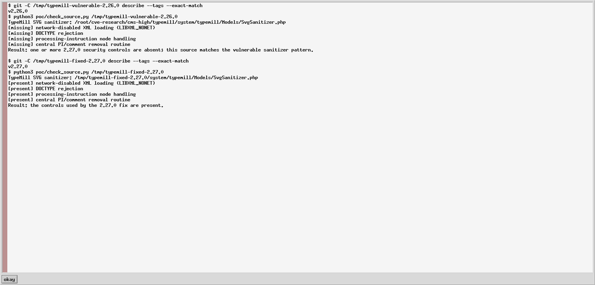
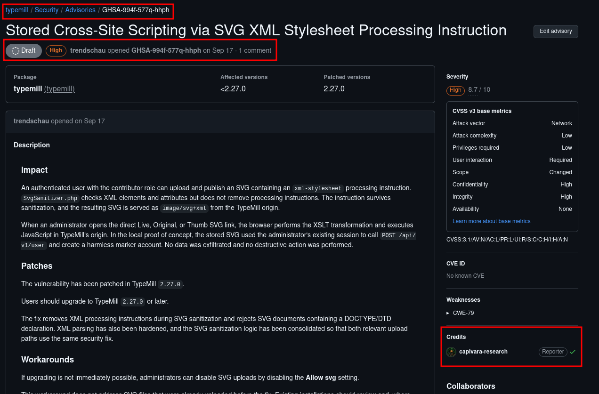

# GHSA-994f-577q-hhph — TypeMill stored XSS via SVG XML stylesheet

Public research reference and safe reproduction material for a stored cross-site scripting vulnerability reported privately to the TypeMill maintainer.

> The maintainer was informed through GitHub Private Vulnerability Reporting on 2026-09-17. TypeMill 2.27.0 contains the fix.

## At a glance

| Field | Value |
|---|---|
| Product | TypeMill CMS |
| Repository | [`typemill/typemill`](https://github.com/typemill/typemill) |
| Affected versions | `< 2.27.0` |
| Fixed version | `2.27.0` |
| Vulnerability | Stored cross-site scripting (stored XSS) |
| Weakness | CWE-79 |
| Required privileges | Authenticated contributor able to upload and publish SVG media |
| Victim interaction | An administrator opens the direct Live, Original, or Thumb SVG URL |
| Severity | High — CVSS 3.1: 8.7 |
| CVSS vector | `CVSS:3.1/AV:N/AC:L/PR:L/UI:R/S:C/C:H/I:H/A:N` |
| Advisory | `GHSA-994f-577q-hhph` |
| CVE | No known CVE at repository publication time |
| Researcher | Fernando Viana — [Capivara Research](https://github.com/capivara-research) |

## Verification evidence

The screenshot below is a direct capture of the checker included in this repository running against exact upstream tags. TypeMill `v2.26.0` lacks all four controls used by the fix; `v2.27.0` contains all four.



What this proves:

- the vulnerable tag does not disable networked XML loading, reject DOCTYPEs, handle processing-instruction nodes, or call the central removal routine;
- the fixed tag contains those four controls;
- the result comes from the public, non-invasive `poc/check_source.py` checker and exact upstream tags.

This is source-level proof of the vulnerable-versus-fixed sanitizer behavior. Browser XSLT behavior can vary, so the screenshot is not presented as universal client-side execution evidence.

## Summary

Before version 2.27.0, TypeMill sanitized the elements and attributes of uploaded SVG documents but did not remove XML processing instructions. An authenticated contributor could therefore upload an SVG containing an `xml-stylesheet` processing instruction. The instruction survived sanitization, and TypeMill served the stored document as `image/svg+xml` from its own origin.

When an administrator opened the direct SVG resource, a browser supporting SVG XSLT processing could transform the document and execute JavaScript in the TypeMill origin. This is stored XSS across a contributor-to-administrator trust boundary.

## Security boundary and impact

The vulnerable flow was:

```text
contributor uploads SVG
        ↓
TypeMill checks XML elements and attributes
        ↓
xml-stylesheet processing instruction remains
        ↓
SVG is stored and served as image/svg+xml
        ↓
administrator opens direct SVG URL
        ↓
XSLT-generated JavaScript runs in the TypeMill origin
```

Code running in that origin can act with the victim's authenticated browser session. The coordinated local validation used the administrator's session to create a harmless marker account. It did not exfiltrate data and did not perform a destructive action. The public PoC in this repository is intentionally less invasive: it only changes text inside its own document and sets a `data-poc` marker.

## Root cause

The pre-fix `SvgSanitizer` iterated over XML elements and their attributes. A processing instruction is neither an element nor an attribute, so this allowlist pass never examined or removed it:

```php
$allElements = $this->xmlDoc->getElementsByTagName("*");

for ($i = 0; $i < $allElements->length; $i++) {
    $currentNode = $allElements->item($i);
    // element and attribute allowlist checks
}
```

This condition is independently fixable and was corrected in the dedicated upstream security commit.

## Safe proof of concept

The [`poc/`](poc/) directory contains:

- [`poc/payload.svg`](poc/payload.svg): a self-contained, harmless demonstration of the surviving `xml-stylesheet` instruction;
- [`poc/check_source.py`](poc/check_source.py): a non-invasive checker for a local TypeMill source tree; and
- [`poc/README.md`](poc/README.md): concise lab setup, reproduction steps, and expected results.

Use only a disposable local installation that you own or are explicitly authorized to test. The PoC performs no network request, reads no cookies, creates no account, and does not modify the TypeMill installation.

### Expected result

| Release | Upload result | Direct SVG result |
|---|---|---|
| TypeMill `< 2.27.0` | The SVG is accepted and the processing instruction remains | The document displays `PoC successful: JavaScript executed in the SVG document origin.` in a browser that processes the XSLT |
| TypeMill `>= 2.27.0` | The SVG may be accepted after sanitization, but the processing instruction is removed | The XSLT/JavaScript marker does not execute |

Browser behavior can vary because some browsers have reduced or removed XSLT support. The source checker provides deterministic evidence of the vulnerable and fixed sanitizer logic without making an HTTP request.

## Fix analysis

Upstream commit [`9ca43c4`](https://github.com/typemill/typemill/commit/9ca43c4a7b6764c5a6ac11a2ccc099b036ee3cef) addresses the issue by:

1. loading XML with `LIBXML_NONET`;
2. rejecting SVG documents containing a DOCTYPE/DTD;
3. recursively removing XML processing instructions and comments; and
4. consolidating both SVG upload paths around the same sanitization routine.

The security commit was made on 2026-09-18. The fix is included in release [`v2.27.0`](https://github.com/typemill/typemill/releases/tag/v2.27.0).

## Remediation and workaround

Upgrade to TypeMill `2.27.0` or later.

If an immediate upgrade is not possible, disable SVG uploads using the **Allow svg** setting. This does not remediate files uploaded before the setting was changed; administrators should review and remove suspicious pre-existing SVG files after upgrading.

## Coordinated disclosure and maintainer notification

| Date | Event |
|---|---|
| 2026-09-17 | Report opened privately with the TypeMill maintainer as `GHSA-994f-577q-hhph` |
| 2026-09-18 | Upstream security fix committed |
| 2026-09-18 | Fixed release `2.27.0` published |
| 2026-10-24 | This public research reference prepared after the fix was available |

The screenshot below records the private advisory, affected and patched versions, severity, reporter attribution, and the maintainer's advisory workspace. It is included as evidence that the maintainer was notified; it does not expose credentials or exploit secrets.



## References

- Private advisory URL (visible to authorized advisory participants until publication): <https://github.com/typemill/typemill/security/advisories/GHSA-994f-577q-hhph>
- TypeMill repository: <https://github.com/typemill/typemill>
- Security fix: <https://github.com/typemill/typemill/commit/9ca43c4a7b6764c5a6ac11a2ccc099b036ee3cef>
- Fixed release: <https://github.com/typemill/typemill/releases/tag/v2.27.0>
- CWE-79: <https://cwe.mitre.org/data/definitions/79.html>

## Credits

Discovered, validated, and reported by **Fernando Viana — Capivara Research** (`capivara-research`). The private GitHub advisory records `capivara-research` as reporter.

## Legal and ethical use

This repository is for defensive research, vendor validation, and authorized testing. Do not upload the payload to systems you do not own or lack explicit permission to assess.
